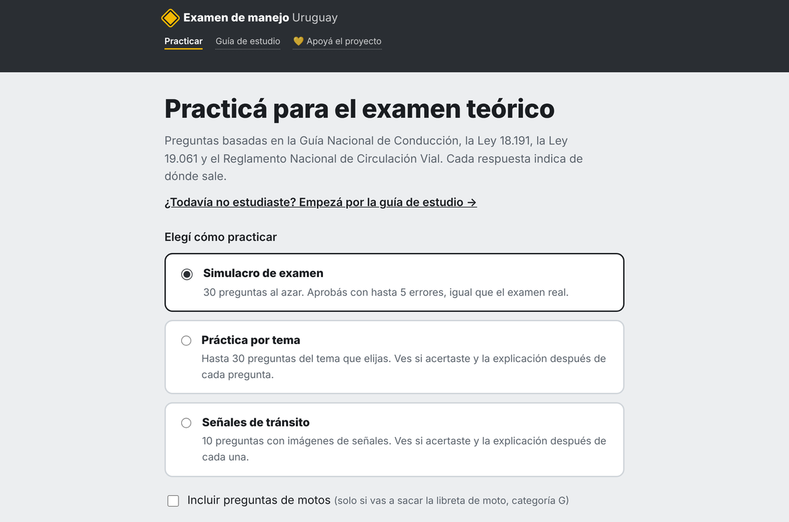
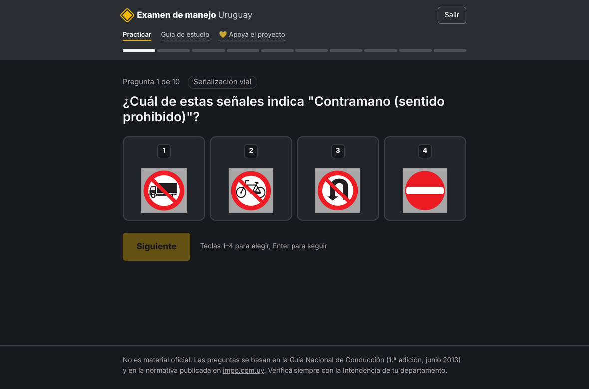
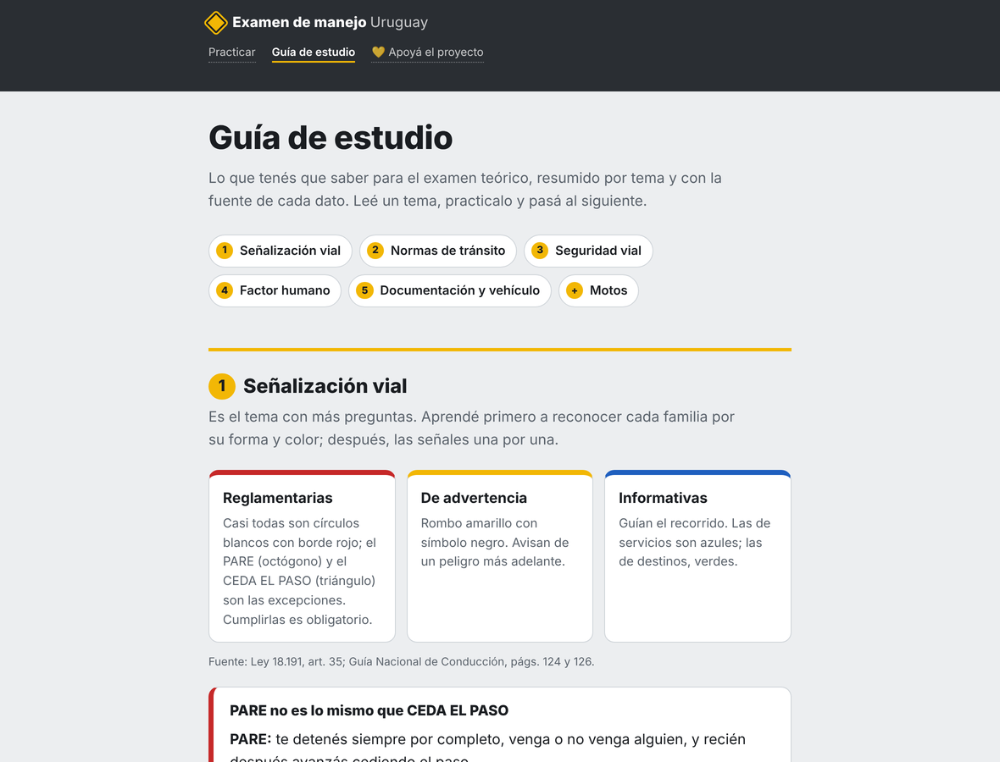
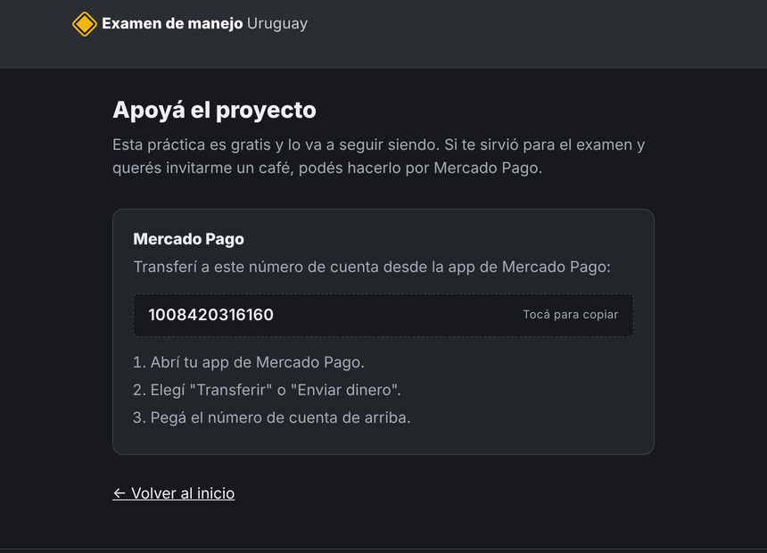
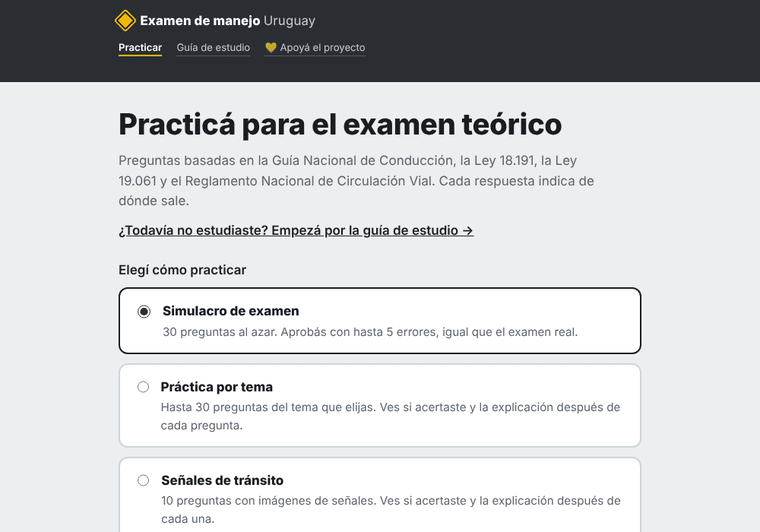
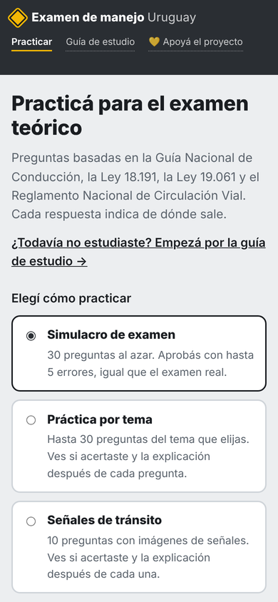

# Examen de manejo · Uruguay

Práctica para el examen teórico de manejo uruguayo: preguntas de opción
múltiple con explicación y fuente legal en cada respuesta.

*(English version below / versión en inglés más abajo)*

## Capturas

| | |
|---|---|
|  |  |
|  |  |



<details>
<summary>Vista en celular</summary>



</details>

---

## Español

### Qué es

Un sitio estático (HTML/CSS/JS puro, sin frameworks) para practicar el
examen teórico de manejo en Uruguay.

- **Simulacro de examen**: 30 preguntas que mezclan los cinco temas en
  proporciones fijas, para que las señales no ocupen todo el examen.
  Aprobás con hasta 5 errores.
- **Práctica por tema**: hasta 30 preguntas del tema que elijas, con la
  explicación después de cada una.
- **Señales de tránsito**: 10 preguntas con imágenes de señales, de cualquier
  tema, para practicar solo las señales.
- **Situaciones de tránsito**: 10 casos prácticos, varios con diagramas
  (quién pasa primero en un cruce, qué indica el agente o el brazo del
  conductor, qué hacer ante una emergencia).
- **Guía de estudio** (`estudiar.html`): el resumen de los cinco temas (y motos)
  con las 53 señales con su imagen, diagramas y la fuente de cada dato. Cada
  tema tiene un botón que lleva directo a practicarlo
  (`index.html?tema=<tema>`, `index.html?modo=signs` o
  `index.html?modo=situaciones`).
- **Preguntas de motos opcionales**: una casilla en el inicio las suma al
  simulacro y a la práctica. Sirve si vas a sacar la libreta de moto
  (categoría G); si no, quedan afuera. La elección se recuerda en el navegador.
- Al terminar, el resultado se ve por tema y se pueden repasar o volver a
  practicar las preguntas falladas.
- Pensado para el celular: funciona bien de 320px para arriba, con el botón
  "Siguiente" siempre a mano.

### Temas

| Tema | Qué incluye | Preguntas |
|------|-------------|-----------|
| Señalización vial | Señales reglamentarias, de advertencia e informativas, marcas en el pavimento y señales luminosas (semáforos), con 53 imágenes de señales reales y diagramas de señales con el brazo, del agente y de líneas | 105 |
| Normas de tránsito y circulación | Velocidades máximas (incluida la zona escolar, 20 km/h), preferencia de paso, adelantamiento, giros, estacionamiento, marcha atrás, con diagramas de cruces | 96 |
| Seguridad vial y legislación | Alcohol cero, cinturón, sistemas de retención infantil, casco, luces bajas, Leyes 18.191 y 19.061, qué hacer en un siniestro | 33 |
| Factor humano y conducción | Tiempo de reacción, fatiga, distracciones, distancia de frenado, física del vehículo, emergencias al volante | 29 |
| Documentación y vehículo | Libreta y documentos, neumáticos, luces, frenos, equipamiento obligatorio | 25 |
| Motos *(opcional)* | Casco, chaleco reflectivo, frenado y manejo de motos y cuatriciclos | 15 |

Cada pregunta indica de dónde sale: Guía Nacional de Conducción, Ley 18.191
(Tránsito y Seguridad Vial), Ley 19.061, Ley 18.113, Reglamento Nacional de
Circulación Vial o el material de Montevideo Tránsito (para las señales).

### Cómo correrlo

**Opción 1: servidor local** (solo hace falta Python):

```bash
cd site
python3 -m http.server 8080
```

Abrí [http://localhost:8080](http://localhost:8080).

**Opción 2: Docker** (nginx sirviendo la carpeta `site/`):

```bash
cd site
docker build -t manejo-uy .
docker run -d -p 8080:80 --name manejo manejo-uy
```

**Opción 3: Terraform** (gestiona el contenedor como infraestructura, con
`plan` / `apply` / `destroy`, usando el provider de Docker local; no hace
falta cuenta de nube):

```bash
cd site && docker build -t manejo-uy .   # primero la imagen
cd ../infra
terraform init
terraform apply
```

Después de cambiar algo en `site/`, hay que reconstruir la imagen y volver a
aplicar (o reiniciar el contenedor) para verlo en Docker.

### Estructura

```
site/               # el sitio (estático)
  index.html        # práctica y simulacro
  estudiar.html     # guía de estudio
  estudiar.css
  donar.html        # página para apoyar el proyecto
  style.css
  app.js
  questions.json    # banco de preguntas
  img/signs/        # imágenes de señales (ver COMO-AGREGAR-SENALES.md)
  img/diagrams/     # diagramas SVG de las preguntas de situaciones
  Dockerfile
infra/              # Terraform para levantarlo con Docker localmente
docs/screenshots/   # capturas y gif usados en este README
```

Cada pregunta en `questions.json` tiene `category` (uno de los temas de
arriba), `topic` (subtema), `question`, `options`, `correct` (índice),
`explanation` y `source`. Opcionales: `image` / `optionImages` para señales,
`moto: true` para las de moto, `scenario: true` para los casos prácticos
(modo "Situaciones de tránsito") y `verify: true` para las que todavía no están
confirmadas (no se muestran).

### Estado

- 303 preguntas en total: 204 de texto, 69 con imágenes de señales y 30 con
  diagramas. 78 son casos prácticos (situaciones).

### Aviso

No es material oficial. Las preguntas se basan en la Guía Nacional de
Conducción (1.ª edición, junio 2013), en normativa publicada en
[impo.com.uy](https://www.impo.com.uy) y en material de Montevideo Tránsito.
Verificá siempre con la Intendencia de tu departamento.

---

## English

### What this is

A static site (plain HTML/CSS/JS, no frameworks) for practicing Uruguay's
written driving exam.

- **Exam simulation**: 30 questions mixing the five topics in fixed
  proportions, so road signs don't take over the exam. You pass with up to
  5 wrong answers.
- **Practice by topic**: up to 30 questions from the topic you pick, with the
  explanation after each one.
- **Road signs**: 10 questions with road-sign images, from any topic, for
  practicing just the signs.
- **Traffic situations**: 10 practical cases, several with diagrams (who goes
  first at an intersection, what the officer's or the driver's arm signal
  means, what to do in an emergency).
- **Study guide** (`estudiar.html`): a summary of the five topics (plus
  motorcycles) with all 53 sign images, diagrams and the source of every
  fact. Each topic has a button that jumps straight into practicing it
  (`index.html?tema=<topic>`, `index.html?modo=signs` or
  `index.html?modo=situaciones`).
- **Optional motorcycle questions**: a checkbox on the start screen adds them
  to the exam and practice. Useful if you're getting a motorcycle license
  (category G); otherwise they're left out. The choice is remembered in the
  browser.
- At the end you get a per-topic breakdown and can review or retry the
  questions you missed.
- Built for phones: works well from 320px wide up, with the Next button
  always within thumb's reach.

### Topics

| Topic | Covers | Questions |
|-------|--------|-----------|
| Señalización vial (road signs) | Regulatory, warning and informational signs, pavement markings and traffic lights, with 53 real sign images plus diagrams of arm signals, officer gestures and road lines | 105 |
| Normas de tránsito y circulación (traffic rules) | Speed limits (including the 20 km/h school-zone limit), right of way, overtaking, turns, parking, reversing, with intersection diagrams | 96 |
| Seguridad vial y legislación (safety and law) | Zero alcohol, seatbelts, child seats, helmets, dipped headlights, Laws 18.191 and 19.061, what to do in a crash | 33 |
| Factor humano y conducción (human factors) | Reaction time, fatigue, distractions, braking distance, vehicle physics, emergencies at the wheel | 29 |
| Documentación y vehículo (documents and vehicle) | License and papers, tires, lights, brakes, required equipment | 25 |
| Motos *(optional)* | Helmets, reflective vests, braking and handling for motorcycles and quads | 15 |

Every question cites its source: the Guía Nacional de Conducción (National
Driving Guide), Ley 18.191 (Traffic and Road Safety Law), Ley 19.061, Ley
18.113, the Reglamento Nacional de Circulación Vial, or Montevideo Tránsito's
official material (for the signs).

### Running it

**Option 1: local server** (just needs Python):

```bash
cd site
python3 -m http.server 8080
```

Open [http://localhost:8080](http://localhost:8080).

**Option 2: Docker** (nginx serving the `site/` folder):

```bash
cd site
docker build -t manejo-uy .
docker run -d -p 8080:80 --name manejo manejo-uy
```

**Option 3: Terraform** (manages the container as infrastructure with
`plan` / `apply` / `destroy`, through the local Docker provider; no cloud
account needed):

```bash
cd site && docker build -t manejo-uy .   # build the image first
cd ../infra
terraform init
terraform apply
```

After changing anything in `site/`, rebuild the image and apply again (or
restart the container) to see it in Docker.

### Structure

```
site/               # the static site
  index.html        # practice and exam simulation
  estudiar.html     # study guide
  estudiar.css
  donar.html        # donation page
  style.css
  app.js
  questions.json    # question bank
  img/signs/        # road-sign images (see COMO-AGREGAR-SENALES.md)
  img/diagrams/     # SVG diagrams for the situation questions
  Dockerfile
infra/              # Terraform config to run it locally via Docker
docs/screenshots/   # screenshots and gif used in this README
```

Each question in `questions.json` has `category` (one of the topics above),
`topic` (subtopic), `question`, `options`, `correct` (index), `explanation`
and `source`. Optional: `image` / `optionImages` for signs, `moto: true` for
motorcycle questions, `scenario: true` for practical cases (the "Situaciones
de tránsito" mode) and `verify: true` for unconfirmed ones (hidden).

### Status

- 303 questions in total: 204 text-only, 69 with road-sign images and 30 with
  diagrams. 78 are practical cases (situations).

### Disclaimer

This is not official material. Questions are based on the Guía Nacional de
Conducción (1st edition, June 2013), regulations published at
[impo.com.uy](https://www.impo.com.uy) and Montevideo Tránsito's material.
Always double-check with your local Intendencia.
